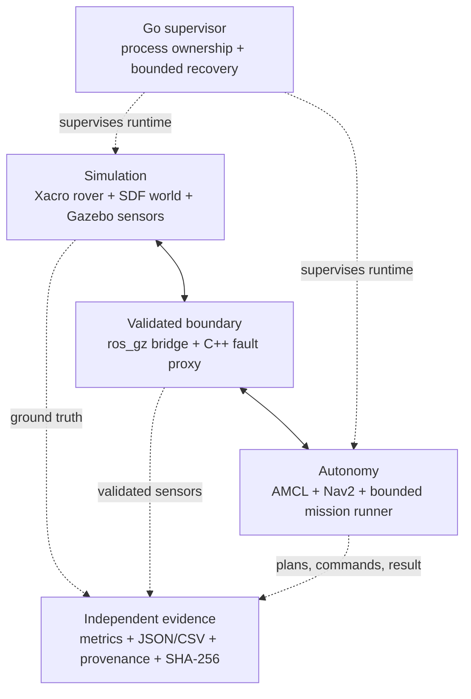
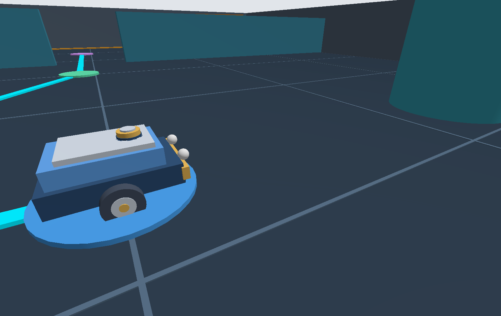
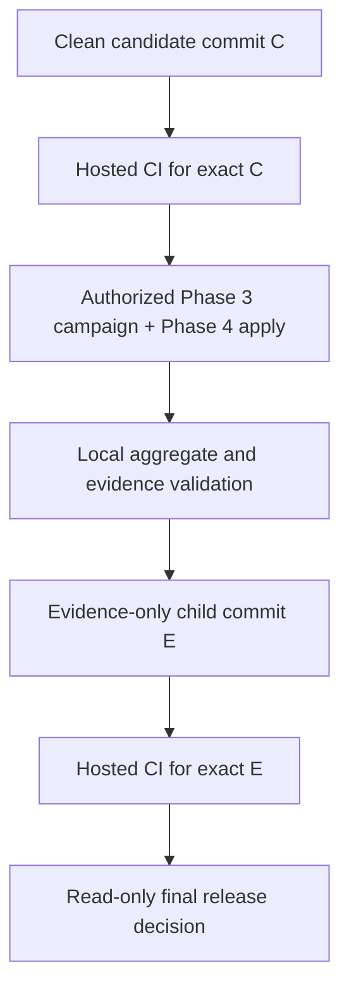

<div align="center">

# RoboTest Lab

### Evidence-driven ROS 2 navigation reliability testbench

**Controlled sensor faults · Independent metrics · Reproducible evidence**


[](https://github.com/Hasan-Al-Hussein/robotest-lab/actions/workflows/robotest-ci.yml)
[](LICENSE)

[Verified scope](#verified-scope) · [Architecture](#architecture) ·
[Evidence ledger](docs/evidence-ledger.md) · [Pipeline](docs/pipeline.md) ·
[Demo guide](docs/demo-script.md)

</div>

RoboTest Lab is a software-in-the-loop platform for testing a differential-drive
robot under repeatable navigation and sensor-fault conditions. It combines an
original Xacro/SDF simulation, ROS 2 Jazzy and Nav2, deterministic LiDAR and
odometry faults, observer-only metrics, bounded verification, and process
supervision. It prioritizes deterministic test engineering and auditable
evidence over visual fidelity.

## Verified scope

| Layer | What is preserved | Evidence boundary |
| --- | --- | --- |
| Simulation and autonomy | Original rover/world, ROS–Gazebo bridge, AMCL, Nav2, mission runner | Implemented; bounded live Phase 1/2 runs recorded |
| Faults and metrics | LiDAR dropout, odometry drift, scenario orchestration, independent measurement | Implemented and non-live tested; no completed 15-run campaign claimed |
| Runtime control | Go supervisor, process-group recovery, systemd and Debian packaging | Implemented and non-live tested; no privileged lifecycle acceptance claimed |
| Hosted verification | [GitHub runner receipt](docs/results/hosted-ci/20260829T210238Z-19597/verification-summary.json) for clean commit [`039effa`](https://github.com/Hasan-Al-Hussein/robotest-lab/commit/039effa496abbf69d006ccca729c6ed26116c2eb) | L2 non-live checks passed; no Gazebo, hardware, campaign, or privileged runtime was started |

The complete distinction between **implemented**, **verified**, and
**unverified** work is recorded in the [evidence ledger](docs/evidence-ledger.md).
The original hosted-CI logs, provenance, source snapshot, and SHA-256 manifest
are preserved under [docs/results/hosted-ci](docs/results/hosted-ci/README.md).

## Why this exists

A robot moving once is not a reliability result. RoboTest was built to answer
harder questions: Did an ordered mission finish? Did the sensor boundary remain
valid? What changed during a dropout or drift fault? Were resource and timing
limits respected? Can the result be tied back to an exact source tree?

| Reliability problem | Engineering response |
| --- | --- |
| Sensor behavior changes during a run | C++ validation and deterministic fault proxy |
| Navigation may look successful while measurements are biased | Observer-only ground-truth, TF, odometry, scan, plan, command, contact, lifecycle, and resource collectors |
| Screenshots cannot prove outcomes | Canonical JSON/CSV, provenance, source/configuration binding, and SHA-256 manifests |
| Processes fail in different ways | Go supervisor with owned process groups, bounded restart policy, systemd integration, and Debian packaging |

## Architecture

<!-- ROBOTEST_PORTFOLIO_DIAGRAM: architecture -->


The [code-connected pipeline](docs/pipeline.md) maps each stage to its source
and data contract. The diagram shows the implemented design; the evidence below
states which parts were actually exercised.

## Evidence-backed development results

### Phase 1 — model, bridge, sensor boundary, and headless runtime

Development run [`20260825T200725Z-1333`](docs/results/phase-1/20260825T200725Z-1333.md)
recorded 103 tests with zero errors or failures, calculated RTF median `0.9999`,
calculated RTF p5 `0.9162`, peak launch-group RSS `795,476 KiB`, and bounded
displacement `0.2962 m`. Its 45-entry run checksum manifest validated completely.

This was a seeded, bounded development run from a dirty worktree. The separate
[RViz screenshot](docs/results/phase-1/rviz-phase1.png) is technical inspection
evidence—not a benchmark chart or proof of release readiness.

### Phase 2 — ordered Nav2 mission

Development run [`20260826T010218Z-466`](docs/results/phase-2/20260826T010218Z-466.md)
recorded that Nav2 returned `SUCCEEDED` after all three ordered waypoints. It
also recorded 213 tests with zero errors and failures, calculated RTF median
`0.9863`, calculated RTF p5 `0.9302`, and peak owned-process-group RSS
`1,372,244 KiB`. All 111 checksum-manifest entries validated.

This was bounded mission/action acceptance from a dirty worktree, not a full
fault campaign. Fault injection, repeated runs, and recovery acceptance remain
separate gates.

### Hosted non-live verification

GitHub Actions run `33274853279` executed on a clean checkout of exact commit
`039effa496abbf69d006ccca729c6ed26116c2eb`. The retained receipt records a
passing L2 check set covering static analysis, a fresh ROS build, package tests,
pure-Python tests, Go race tests, and CLI smoke checks. Its own runtime-scope
record says Gazebo, hardware, Phase 3 campaigns, Phase 4 apply, and systemd
mutation were not exercised. See the [retained run index](docs/results/hosted-ci/README.md)
for the exact counts and original logs.

<!-- ROBOTEST_RELEASE_STATUS_START -->
## Final acceptance status

The clean-source hosted non-live L2 gate passed for exact commit `039effa`.
The repository does not contain an accepted Phase 3 campaign result.

No completed 15-run campaign, privileged lifecycle acceptance, or final release
qualification is claimed.
<!-- ROBOTEST_RELEASE_STATUS_END -->

## Implemented model preview

<div align="center">
  <a href="docs/showcase/robotest-rover-close.png"></a>
  <br />
  <sub>Genuine Gazebo capture of the tracked Xacro rover and test-bay model. It illustrates the implementation; it does not prove a test result.</sub>
</div>

The remaining genuine simulator views are retained in
[docs/showcase](docs/showcase). The test-bay route and waypoint markers are
presentation geometry; they have no sensors, plugins, dynamics, or collision
role. The editable originals and complete media inventory are catalogued in the
[evidence ledger](docs/evidence-ledger.md#editable-source-and-media-inventory).

## Technology and repository map

| Area | Main components |
| --- | --- |
| Simulation | Gazebo Harmonic, original SDF world, Xacro robot, `ros_gz_bridge` |
| Robotics | ROS 2 Jazzy, Nav2, AMCL, TF2, lifecycle nodes, ROS actions |
| Runtime code | C++17 sensor/contact components, Python 3.12 orchestration/evidence, Go supervisor |
| Verification | Colcon/ament, Pytest, Ruff, schema validation, canonical JSON/CSV, SHA-256 manifests |
| Delivery | Debian package, systemd unit, WSL2 Ubuntu 24.04, GitHub Actions gates |

| Path | Purpose |
| --- | --- |
| `src/` | Eight ROS 2 packages |
| `scenarios/` | Versioned baseline and fault scenarios |
| `supervisor/` | Go process supervisor |
| `scripts/` | Guarded setup and evidence-producing verification |
| `tests/` | Unit, contract, integration, and hostile evidence tests |
| `packaging/debian/` | Debian packaging |
| `docs/` | Architecture, decisions, testing, preserved results, and case study |
| `artifacts/evidence/phase0/` | Checked-in environment and dependency evidence |

## Reproduction commands

These commands are retained as the repository's canonical replay surface. They
target the verified WSL2 distribution named `Ubuntu` (Ubuntu 24.04), not Docker.
`Ubuntu-20.04` is explicitly out of scope. Mutating setup steps require their
literal `--apply` flag and must only be run with authorization.

<details>
<summary><strong>Phase 0 — repository, storage, dependency, and aggregate gates</strong></summary>

The source check is read-only:

```bash
cd /home/hasan/robotest-lab
scripts/setup_ros2_repository.sh --check
```

Apply the pinned official ROS source package:

```bash
cd /home/hasan/robotest-lab
scripts/setup_ros2_repository.sh --apply
```

Simulate the dependency plan and enforce storage gates:

```bash
cd /home/hasan/robotest-lab
scripts/verify_phase0_preinstall.sh
```

Install the validated manifest and run the post-install verifier:

```bash
cd /home/hasan/robotest-lab
scripts/install_dependencies.sh --apply
```

Repeat the read-only Phase 0 check:

```bash
cd /home/hasan/robotest-lab
scripts/verify_phase0.sh
```

The bare aggregate intentionally exits `3` (`INCOMPLETE`) until exact
caller-selected release evidence is validated separately:

```bash
cd /home/hasan/robotest-lab
scripts/verify_all.sh
```

</details>

<details>
<summary><strong>Phase 1 and Phase 2 — bounded live development gates</strong></summary>

```bash
cd /home/hasan/robotest-lab
taskset -c 0-5 scripts/verify_phase1.sh
```

```bash
cd /home/hasan/robotest-lab
ROBOTEST_SIM_SEED=42 ROBOTEST_CPUSET=0-5 scripts/verify_phase2.sh
```

</details>

<details>
<summary><strong>Phase 3–5 — static and non-live surfaces</strong></summary>

These do not authorize a Phase 3 campaign, privileged Phase 4 lifecycle run,
publication, or release verdict.

```bash
cd /home/hasan/robotest-lab
taskset -c 0-5 scripts/verify_phase3.sh
```

```bash
cd /home/hasan/robotest-lab
taskset -c 0-5 scripts/verify_phase4.sh
```

```bash
cd /home/hasan/robotest-lab
scripts/verify_phase5.sh --local
```

</details>

## Release mechanics retained for audit

<details>
<summary><strong>Show the evidence-join flow</strong></summary>

<!-- ROBOTEST_PORTFOLIO_DIAGRAM: release-flow -->


The current repository has not completed this full join. Static success is not
promoted into runtime or release acceptance. The canonical order and binding
rules are in [docs/testing/phase5-ci.md](docs/testing/phase5-ci.md).

</details>

## Safety and platform boundary

- Core runtime target: WSL2 `Ubuntu`, Ubuntu 24.04, ROS 2 Jazzy, Gazebo
  Harmonic, Nav2, C++17, Python 3.12, and Go 1.22 or newer.
- Docker is not part of the RoboTest core workflow; unrelated Docker resources
  are not RoboTest evidence.
- Setup scripts do not unregister, export, import, terminate, or change the
  default of any WSL distribution.
- Apt arguments are parsed literally, and the ROS source package is pinned and
  SHA-256 verified.
- Pre-install verification blocks dependency installation if projected usage
  exceeds 18 GiB or would leave less than 20 GiB free on the Windows host.

## Roadmap and evidence gates

<!-- ROBOTEST_RELEASE_ROADMAP_START -->
| Phase | Honest status | Preserved result |
| --- | --- | --- |
| 0 | Verified locally | Environment foundation, exact dependency manifest, versions, and storage gates |
| 1 | Verified development | Original robot/world, sensor boundary, headless checks, and separate RViz evidence |
| 2 | Verified development | Seeded 3/3-waypoint mission, matching JSON/CSV, and independent audit |
| 3 | Implemented; runtime acceptance incomplete | Repeatable baseline, obstacle, LiDAR-dropout, and odometry-drift campaign machinery |
| 4 | Implemented; privileged acceptance incomplete | Go supervisor, systemd, Debian package, and lifecycle verifier |
| 5 | Hosted non-live L2 verified for `039effa`; final qualification incomplete | Clean-source CI receipt and portfolio/evidence contracts |
<!-- ROBOTEST_RELEASE_ROADMAP_END -->

## Documentation map

- [Evidence ledger](docs/evidence-ledger.md) — one honest index of implemented,
  verified, incomplete, and absent material.
- [Hosted CI receipt](docs/results/hosted-ci/README.md) — exact logs, provenance,
  summary, source snapshot, and checksum manifest.
- [Pipeline guide](docs/pipeline.md) — complete robot loop linked to source.
- [Demo guide](docs/demo-script.md) — inspection and bounded demonstration.
- [Metrics contract](docs/architecture/metrics-contract.md) and
  [topic/TF contract](docs/architecture/topic-and-tf-contract.md).
- [Acceptance criteria](docs/testing/acceptance-criteria.md) and
  [verification matrix](docs/testing/verification-matrix.md).
- [Case study](docs/case-study.md), [portfolio notes](docs/portfolio.md), and
  [troubleshooting guide](docs/troubleshooting.md).

## Contributing, security, and license

See [CONTRIBUTING.md](CONTRIBUTING.md) for the evidence-first workflow and
[SECURITY.md](SECURITY.md) for the local-only security boundary. Original
RoboTest Lab code is licensed under the [Apache License 2.0](LICENSE); third-party
software retains its own licenses as recorded in [NOTICE.md](NOTICE.md).
